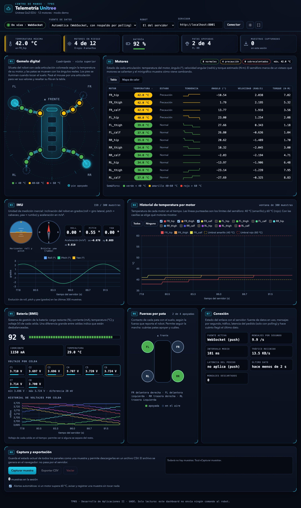
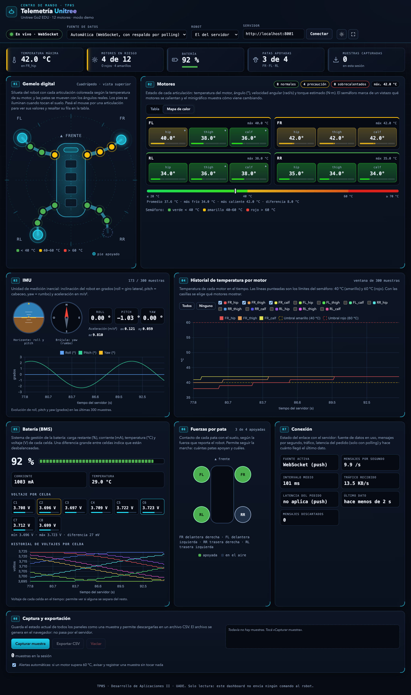
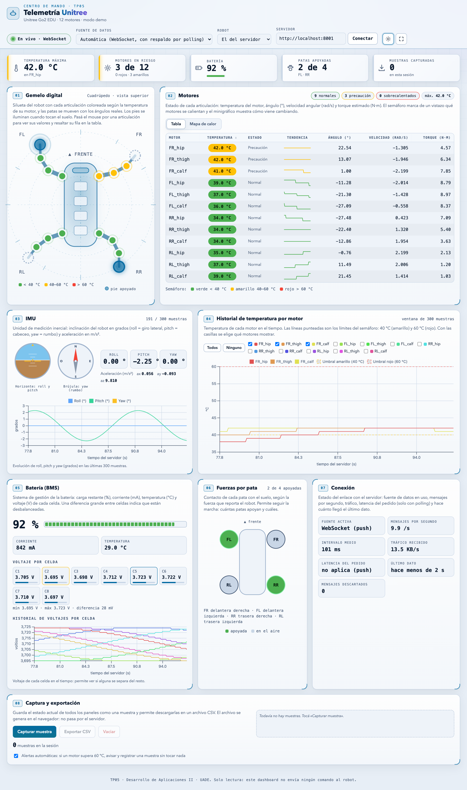
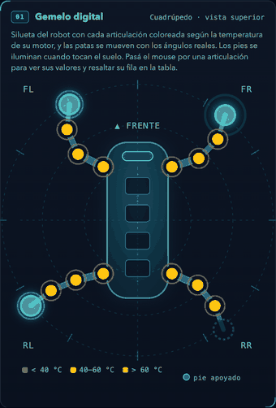
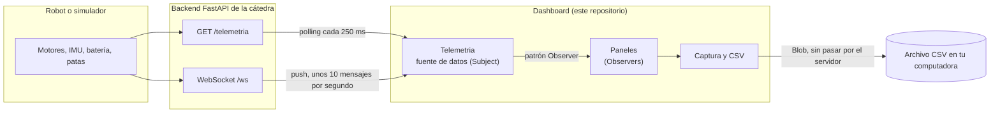
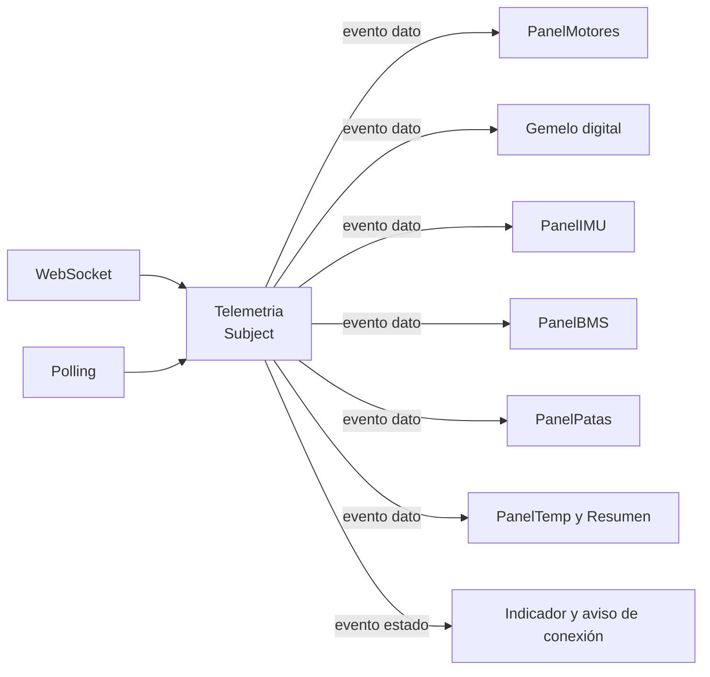
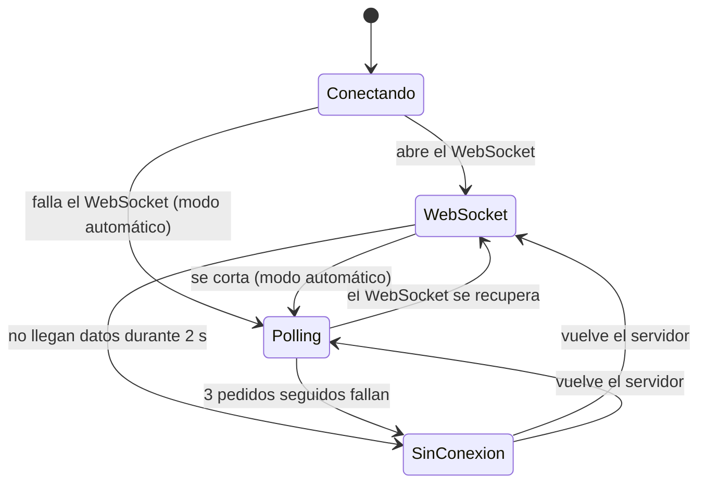
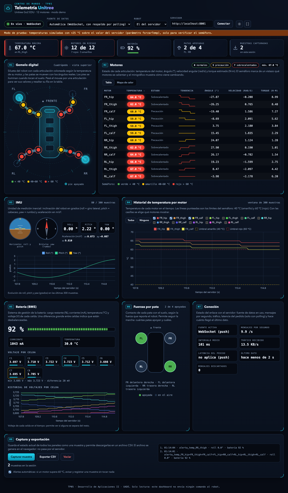
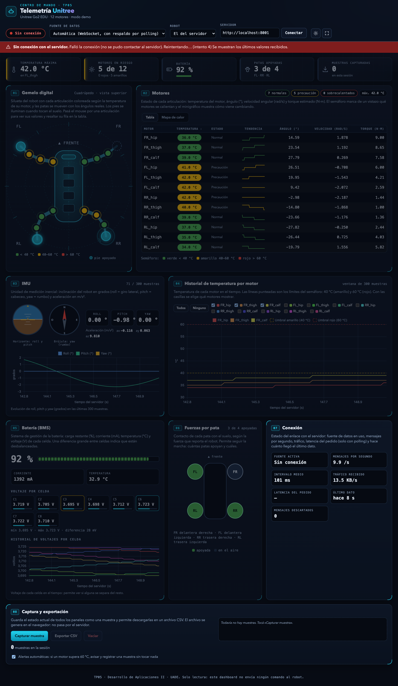

# Dashboard web de telemetría para el robot Unitree Go2

TP05 de **Desarrollo de Aplicaciones II** (UADE). Es la versión web del monitor de motores Unitree (*electroSim*): una página que muestra en tiempo real el estado de un robot (motores, inclinación, batería y apoyo de las patas), permite guardar muestras y exportarlas a un archivo CSV.



**Contenido**

1. [Qué hace](#1-qué-hace)
2. [Cómo funciona](#2-cómo-funciona)
3. [Cómo levantarlo](#3-cómo-levantarlo)
4. [Qué datos consume](#4-qué-datos-consume)
5. [Estructura del repositorio](#5-estructura-del-repositorio)
6. [Pruebas](#6-pruebas)
7. [Problemas frecuentes](#7-problemas-frecuentes)
8. [Limitaciones y notas](#8-limitaciones-y-notas)
9. [Entregables](#9-entregables)

---

## 1. Qué hace

El dashboard se conecta a un servidor de telemetría (el backend FastAPI que provee la cátedra) y presenta la información del robot en cuatro paneles obligatorios, más algunos complementos.

| Panel | Qué muestra |
|---|---|
| **Gemelo digital** | Silueta del robot (vista superior del Go2) con cada articulación coloreada según el semáforo de su motor. **Las patas se mueven en vivo** con los ángulos reales de los motores (cadera, muslo y pantorrilla), con una animación suave entre dato y dato, y los pies se iluminan al tocar el suelo. La pose es una aproximación visual de la vista superior, no una cinemática exacta; se desactiva si el sistema pide reducir animaciones. Al pasar el mouse por una articulación se resalta su fila en la tabla y al hacer clic se salta a ella. |
| **Motores** | Una fila por motor (12 en el Go2): **temperatura con semáforo** (verde menos de 40 °C, amarillo de 40 a 60, rojo más de 60), minigráfico de **tendencia** de los últimos 60 datos, ángulo en grados, velocidad angular en rad/s y torque estimado en N·m. La tabla se ordena por temperatura y hay una vista de **mapa de calor**: una tarjeta por pata ubicada como se ve el robot desde arriba, con un color continuo por motor (verdes bajo 40 °C, de amarillo a naranja hasta 60 °C y rojo por encima), un termómetro con los cortes del semáforo, una flecha si la temperatura sube o baja, el máximo de cada pata y una escala con el promedio general. Al hacer clic en un motor se salta a su fila de la tabla. |
| **IMU** | Inclinación del robot en grados (*roll*: giro lateral, *pitch*: cabeceo, *yaw*: rumbo) y aceleración en m/s². Incluye un horizonte artificial, una brújula y un gráfico histórico de las últimas 300 muestras. |
| **Batería (BMS)** | Carga restante (%), corriente (mA), temperatura (°C) y voltaje de cada celda, con la celda más baja y la más alta resaltadas, y un gráfico histórico por celda. |
| **Fuerzas por pata** | Si cada pata está apoyada en el suelo o en el aire (FR delantera derecha, FL delantera izquierda, RR trasera derecha, RL trasera izquierda). |
| **Historial de temperatura** | Temperatura de cada motor en el tiempo, con los umbrales del semáforo dibujados. Se elige qué motores ver. |
| **Conexión** | Fuente de datos en uso, mensajes por segundo, intervalo medio, tráfico, latencia y antigüedad del último dato. |
| **Captura y exportación** | «Capturar muestra» guarda el estado actual de todos los paneles; «Exportar CSV» descarga todas las muestras. |

Además:

- **Resumen de un vistazo:** tarjetas fijas con la temperatura máxima (y en qué motor), los motores en riesgo, la batería, las patas apoyadas y las muestras capturadas.
- **Alertas automáticas:** si un motor supera 60 °C se avisa en pantalla y se registra una muestra sin tocar nada.
- **Pérdida de conexión:** aviso rojo visible, los paneles se atenúan mostrando los últimos valores, y se reintenta solo. La página nunca se rompe.
- **Robot Go2:** la cantidad de motores y los nombres salen de los datos. Un selector permite pedir explícitamente el Go2 o el robot que atienda el servidor.
- **Identidad visual de «centro de mando»:** fondo de plano técnico, paneles numerados con esquinas marcadas, cifras en tipografía monoespaciada, batería segmentada y un pulso en el indicador de conexión que late con cada dato recibido (se desactiva si el sistema pide reducir animaciones).
- **Tema oscuro («mando») y claro («plano»)** y **pantalla completa**, pensados para proyectar en el laboratorio. Se adapta a tablet y celular.
- **Solo lectura:** el dashboard no envía ningún comando al robot.

| Mapa de calor | Tema claro |
|---|---|
|  |  |

| Gemelo digital en movimiento | Vista de celular |
|---|---|
|  |  |

---

## 2. Cómo funciona

### Arquitectura

Frontend y backend son independientes: se comunican únicamente por la API definida. El dashboard no tiene framework, solo HTML, CSS y JavaScript; Chart.js se carga por CDN.



### Patrón Observer

La pantalla y la fuente de datos están desacopladas con el patrón **Observer** (publicador y suscriptores):

- **Subject (publicador):** la clase `Telemetria`. No sabe qué se dibuja; solo recibe mensajes, los valida y los publica.
- **Eventos:** `dato` (llegó un mensaje válido) y `estado` (cambió la conexión: conectando, WebSocket, polling o caído).
- **Suscripción:** `telemetria.en('dato', fn)` agrega un suscriptor; `_emitir(evento, arg)` los recorre y los avisa. Cada aviso va protegido con `try/catch`: si un suscriptor falla, el error se registra y los demás siguen recibiendo datos.
- **Observers:** al recibir un `dato`, la aplicación actualiza `PanelMotores`, `Gemelo`, `PanelIMU`, `PanelBMS`, `PanelCeldas`, `PanelPatas`, `PanelTemp`, `Resumen` y las alertas; al recibir un `estado` actualiza el indicador y el aviso de conexión.



Qué se gana: el WebSocket y el polling son intercambiables sin tocar ningún panel, cada panel se agrega o se quita con una suscripción, y la capa de datos se prueba con Node sin navegador (`test_datos.js`).

### Los cinco bloques de `dashboard.js`

1. **Configuración y lógica pura:** constantes, semáforo, buffer circular, validación de mensajes, armado del CSV. Son funciones sin acceso a la pantalla, por eso se pueden probar con Node.
2. **`Telemetria` (acceso a datos):** obtiene los mensajes del servidor y avisa a quien se suscribió (patrón **Observer**, ver arriba). La pantalla no sabe si el dato llegó por WebSocket o por polling.
3. **Paneles:** un objeto por panel (`PanelMotores`, `Gemelo`, `PanelIMU`, `PanelBMS`, `PanelCeldas`, `PanelPatas`, `PanelTemp`, `Resumen`), cada uno con `construir()` y `actualizar()`. Todo el texto se escribe con `textContent`: ningún dato del servidor se interpreta como HTML.
4. **Captura y exportación CSV.**
5. **Aplicación:** conecta todo y atiende los botones y selectores.

### Cómo obtiene los datos

`Telemetria` tiene tres modos, que se eligen en el selector «Fuente de datos»:

| Modo | Qué hace |
|---|---|
| **Automático** (por defecto) | Intenta el WebSocket. Si falla, sigue por polling mientras reintenta el WebSocket cada vez con más espera (de 1 s hasta 10 s) y vuelve a él apenas se recupera. |
| **Solo WebSocket** | Recibe datos en modo push (unos 10 mensajes por segundo). Si se corta, reconecta. |
| **Solo polling** | Pide `GET /telemetria` cada 250 ms (la consigna pide 500 ms como máximo). Un pedido por vez: el siguiente se agenda recién cuando termina el anterior, y cada pedido tiene un tiempo máximo de 2 s. |



Cada mensaje se valida contra el contrato (si no tiene la forma esperada se descarta y se cuenta). Un detector revisa cada segundo que sigan llegando datos, aunque el navegador no avise del corte.

Un **robot elegido** (`?modelo=go2`) se pide como `GET /telemetria?modelo=…`. El WebSocket no admite parámetros, así que con un robot elegido se usa polling. Si el servidor atiende otro robot, el aviso muestra el motivo que da el servidor.

### Gráficos con buffer circular

Los gráficos de Chart.js (IMU, temperatura y celdas) guardan **300 muestras** (30 segundos a 10 Hz). Al llenarse se descarta la más antigua y se agrega la nueva. El gráfico **no se recrea**: se actualiza el mismo componente sin animación, para que no se trabe.

### Captura y CSV

«Capturar muestra» agrega al array de la sesión un registro con la hora y los valores de todos los paneles. «Exportar CSV» arma el archivo **en el navegador con la API Blob** y lo descarga, sin pasar por el servidor.

Cada muestra es una fila. Las columnas son: `fecha_hora` (UTC), `hora_local`, `ts_servidor_s`, `modelo`, `evento` (`manual` o `alerta_temp_…`), la IMU (`imu_roll`, `imu_pitch`, `imu_yaw`, `imu_ax`, `imu_ay`, `imu_az`), la batería (`bms_soc_pct`, `bms_corriente_ma`, `bms_temperatura_c` y una columna por celda), las patas (`pata_FR`, `pata_FL`, `pata_RR`, `pata_RL`) y, por cada motor, cuatro columnas: temperatura, ángulo, velocidad y torque. Con el Go2 son 74 columnas. El archivo lleva marca de orden de bytes para que Excel lea bien las tildes, y los textos que empiecen con `=`, `+`, `-` o `@` se escapan para que Excel no los tome como fórmulas.

### Detalles que conviene conocer

- **Semáforo:** menos de 40 °C verde, de 40 a 60 °C amarillo, más de 60 °C rojo (60,0 °C cuenta como amarillo).
- **Alertas:** se disparan al pasar los 60 °C y se rearman recién al bajar de 58 °C, para que un motor en el límite no avise sin parar. Si varios motores cruzan el límite a la vez, se registra una sola muestra.
- **Nombres de los motores:** los manda el servidor; si no, se usan los estándar del Go2.
- **Preferencias:** servidor, fuente, robot y tema se recuerdan en el navegador.

---

## 3. Cómo levantarlo

Hacen falta dos cosas: **el servidor de telemetría** (backend de la cátedra) y **el dashboard** (este repositorio).

### Requisitos

- **Python 3.11 o superior** para el servidor. Con Python 3.10 el WebSocket se corta después del primer mensaje (el servidor captura `TimeoutError` y en 3.10 `asyncio.wait_for` lanza otra clase). El dashboard lo tolera y sigue por polling, pero no recibe datos en modo push.
- Un navegador moderno (probado en Chrome).
- Conexión a internet: Chart.js se carga desde un CDN. Sin internet el dashboard funciona, pero sin gráficos.
- Git. Node.js es opcional: solo para correr las pruebas.

### Paso 1. Levantar el servidor de telemetría

El backend es del repositorio de la cátedra, [`tsamaan/UadeRobotLab`](https://github.com/tsamaan/UadeRobotLab). En **modo demo** inventa datos de un robot que camina, sin necesidad del robot ni del simulador.

macOS o Linux:

```bash
git clone https://github.com/tsamaan/UadeRobotLab.git
python3 -m venv ~/tp05-venv
source ~/tp05-venv/bin/activate
pip install fastapi uvicorn websockets
cd UadeRobotLab/05LaboratoriosTPs/TP05_Desarrollo_de_Aplicaciones_II/entorno
python arrancar_api.py --demo --robot go2
```

Windows (PowerShell):

```powershell
git clone https://github.com/tsamaan/UadeRobotLab.git
py -3.11 -m venv $HOME\tp05-venv
& $HOME\tp05-venv\Scripts\Activate.ps1
pip install fastapi uvicorn websockets
cd UadeRobotLab\05LaboratoriosTPs\TP05_Desarrollo_de_Aplicaciones_II\entorno
python arrancar_api.py --demo --robot go2
```

El servidor imprime la dirección a la que hay que pegarle, por ejemplo `http://192.168.0.5:8001`. Para comprobar que anda, abrí `http://localhost:8001/telemetria` en el navegador: tiene que aparecer un JSON.

### Paso 2. Abrir el dashboard

```bash
git clone https://github.com/feliforte14/TP-Telemetria.git
cd TP-Telemetria
python3 -m http.server 8090
```

Y entrar a **http://localhost:8090/dashboard.html**. También se puede abrir `dashboard.html` con doble clic, sin servidor web.

Si el servidor de telemetría está en la misma máquina, el dashboard lo encuentra solo: prueba `http://localhost:8001` (laboratorio) y `http://localhost:8000` (servidor de ejemplo del enunciado) y usa el que responda. Si el servidor está en otra máquina, escribí su dirección en el campo **Servidor** de la barra superior, o agregá `?api=http://IP:8001` a la dirección de la página.

### Otras fuentes de datos

- **Simulador de la cátedra:** con `INICIAR_TP05.sh` o `INICIAR_TP05.bat` (del mismo repositorio de la cátedra) se levanta el simulador MuJoCo y el backend. El dashboard no cambia.
- **Robot real (en el laboratorio):** el backend es el mismo. Solo hay que cambiar la dirección en el campo **Servidor**.

### Parámetros de la dirección (opcionales)

| Parámetro | Efecto |
|---|---|
| `?api=http://IP:8001` | Servidor de telemetría. |
| `?fuente=auto`, `ws` o `polling` | Fuente de datos. |
| `?modelo=go2` | Robot a pedir (usa polling). |
| `?forzarTemp=25` | Suma 25 °C a las temperaturas mostradas, **solo para verificar el semáforo en rojo**, porque el modo demo no pasa de unos 43 °C. El dashboard lo avisa en pantalla. |

---

## 4. Qué datos consume

El dashboard solo **lee**. Usa tres puntos del servidor y todos devuelven el mismo formato:

| Punto | Para qué |
|---|---|
| `GET /telemetria` | Todo junto: motores, IMU, batería y patas (polling). |
| `WS /ws` | El mismo JSON en modo push, unas 10 veces por segundo. |
| `GET /info` | Nombre del robot y modo (opcional: solo mejora el título). |

```json
{
  "modelo": "go2",
  "ts": 16.24,
  "motores": [
    { "id": 0, "nombre": "FR_hip", "angulo": 45.84, "velocidad": -0.218, "torque": 1.31, "temperatura": 30.0 }
  ],
  "imu":     { "roll": -1.39, "pitch": -1.06, "yaw": 78.2, "ax": -0.043, "ay": -0.012, "az": 9.79 },
  "bms":     { "soc": 86, "corriente": 1200, "temperatura": 31.5, "celdas": [3.70, 3.71] },
  "fuerzas": { "FR": 1, "FL": 0, "RR": 0, "RL": 1 }
}
```

Unidades: ángulo en grados, velocidad en rad/s, torque en N·m, temperatura en °C, corriente en mA, voltaje en V, `fuerzas` 1 = apoyada y 0 = en el aire.

---

## 5. Estructura del repositorio

```
TP-Telemetria/
├── dashboard.html        Estructura de la página: paneles numerados, controles e íconos
├── dashboard.css         Estilos: temas «mando» (oscuro) y «plano» (claro), diseño adaptable
├── dashboard.js          Toda la lógica (los cinco bloques descritos arriba)
├── pruebas/
│   ├── test_logica.js    Pruebas de las funciones puras
│   └── test_datos.js     Pruebas de la capa de datos contra un servidor falso
├── entregables/
│   ├── capturas/         Capturas de pantalla del dashboard
│   └── csv/              CSV exportado en una sesión de prueba
└── README.md
```

---

## 6. Pruebas

Son 34 pruebas, sin dependencias. Hace falta Node.js (probado con la versión 22):

```bash
node pruebas/test_logica.js
node pruebas/test_datos.js
```

Cubren el semáforo, el mapa de calor (escala, colores y tendencias), la disposición y la pose del gemelo digital (cada articulación dentro del dibujo, sin superponerse, con huesos de largo constante y simetría izquierda-derecha), el cálculo de las tendencias, el buffer circular, el armado y el escape del CSV, las alertas con su histéresis, y la capa de datos contra un servidor falso: polling, robot elegido, error 409, caída del servidor y reconexión.

---

## 7. Problemas frecuentes

| Qué pasa | Qué hacer |
|---|---|
| «Sin conexión con el servidor» | Abrí `http://localhost:8001/telemetria` en el navegador. Si no aparece el JSON, el servidor no está levantado. |
| Dice «polling» y nunca «WebSocket» | Revisá la versión de Python del servidor (tiene que ser 3.11 o más) y que esté instalado `websockets`. |
| No aparecen los gráficos | Faltó internet para cargar Chart.js. El resto del dashboard funciona. |
| Aviso de que el servidor está conectado a otro robot | El servidor atiende un solo robot. Elegí «El del servidor» en el selector Robot, o levantalo con el robot que querés. |
| Los voltajes de celda aparecen vacíos | El simulador de la cátedra no reporta celdas de batería. El modo `--demo` sí. |
| Las temperaturas no pasan de 43 °C | Es normal en el modo demo. Para ver el rojo, usá `?forzarTemp=25`. |
| Error de CORS | Casi siempre es una dirección equivocada en el campo **Servidor**. |

---

## 8. Limitaciones y notas

- **Algunos valores del simulador son derivados:** el simulador mueve el robot pero no calcula física. El ángulo y la velocidad de los motores y el yaw son reales; el torque, la temperatura, el roll y el pitch, las fuerzas de pata y la batería se derivan del movimiento. Con el robot real esos números serán otros: conviene tenerlo presente si se usan umbrales o alarmas.
- **Solo Go2:** el dashboard está pensado para el Go2 (12 motores). Si el servidor entrega otra cantidad de motores, la tabla y los gráficos funcionan igual, pero el gemelo digital se oculta.
- **El servidor de la cátedra escucha en todas las interfaces y tiene CORS abierto.** Usarlo solo en la red cerrada del laboratorio y no exponerlo a internet.

---

## 9. Entregables

- **Código:** `dashboard.html`, `dashboard.css` y `dashboard.js`.
- **Capturas de pantalla** en [`entregables/capturas/`](entregables/capturas/): dashboard completo con el gemelo digital, los cuatro paneles y el semáforo, tema claro, mapa de calor, captura y exportación, vista de celular, gemelo digital animado (GIF), semáforo en rojo (con `?forzarTemp=25`, temperaturas simuladas y avisado en la propia captura), y pérdida de conexión.
- **CSV exportado** en [`entregables/csv/`](entregables/csv/): sesión de prueba con 12 muestras capturadas manualmente con el botón.
- **Documento técnico** (2 páginas: arquitectura, decisiones de diseño y polling vs WebSocket): [`entregables/documentos/Documento-tecnico-TP05.pdf`](entregables/documentos/Documento-tecnico-TP05.pdf).
- **Guía del sistema** (qué hace, qué usa y los conceptos: cliente-servidor, WebSocket, polling, Observer): [`entregables/documentos/Guia-del-sistema-TP05.pdf`](entregables/documentos/Guia-del-sistema-TP05.pdf). El código fuente de ambos está en `entregables/documentos/fuente/`.

| Semáforo en rojo (simulado) | Pérdida de conexión |
|---|---|
|  |  |

---

*TP05 · Desarrollo de Aplicaciones II · Universidad Argentina de la Empresa (UADE), Carreras de Informática. Backend provisto por la cátedra: [tsamaan/UadeRobotLab](https://github.com/tsamaan/UadeRobotLab).*
